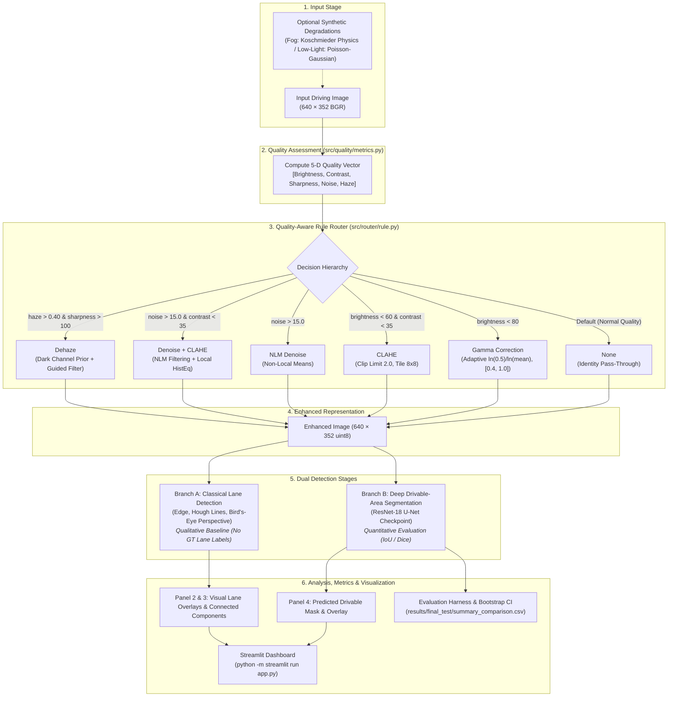

# Quality-Aware Adaptive Enhancement for Lane and Drivable-Area Detection

> **Digital Image Processing (DIP) Course Project · October–November 2026**

---

## 1. Executive Summary & Overview

This project implements an end-to-end computer vision and digital image processing pipeline designed for autonomous driving perception under adverse environmental conditions (fog, low light, haze, sensor noise).

The system integrates:
1. **5-D Quality Assessment (`src/quality/`)**: Objective metrics computing brightness, contrast, sharpness, noise (Immerkaer Laplacian estimator), and haze (Dark Channel Prior) without reference images.
2. **Quality-Aware Rule Router (`src/router/`)**: Deterministic decision tree routing driving scenes to tailored enhancement operations or preserving clean frames via identity bypass.
3. **Pure-Function DIP Enhancement Library (`src/enhance/`)**: Reimplemented Contrast-Limited Adaptive Histogram Equalization (CLAHE), adaptive power-law gamma transformation, Dark Channel Prior dehazing with guided filtering, and Non-Local Means (NLM) denoising.
4. **Dual Detection Stages**:
   - **Branch A (Qualitative Classical Baseline)**: Hough transform with edge detection, region-of-interest masking, and inverse perspective mapping for lane visualization.
   - **Branch B (Quantitative Deep Segmentation)**: ResNet-18 encoder-decoder U-Net (`smp_unet_resnet18`) trained for binary drivable-area semantic segmentation.
5. **Interactive Dashboard & Evaluation Suite**: A 6-panel Streamlit dashboard ([`app.py`](file:///c:/Users/Admin/OneDrive/Desktop/DIP%20project/app.py)) with real-time inspection, full offline metrics evaluation with 95% bootstrap confidence intervals, and strict integrity checks.

---

## 2. Pipeline Architecture & System Block Diagram



### Text / ASCII Pipeline Flow
```
[Driving Image: 640x352 BGR] 
            │
            ▼
[Quality Assessment (metrics.py)] ──► [Brightness, Contrast, Sharpness, Noise, Haze]
            │
            ▼
[Rule Router (rule.py)] ───────────► {none | gamma | dehaze | clahe | denoise | denoise_clahe}
            │
            ▼
[Enhanced Image: 640x352 BGR]
            ├──► [Branch A: Classical Hough Lane Pipeline] ──► Qualitative Overlays (25% Line Yield)
            └──► [Branch B: ResNet-18 U-Net Segmentation]  ──► Quantitative Drivable Area (mIoU / Dice)
```

---

## 3. Repository Structure

```
├── configs/                     # Centralized YAML configuration files
│   ├── data.yaml                # Split sizes (5600/700/700) and resolution specs
│   ├── enhance.yaml             # Parametric bounds for CLAHE, gamma, dehazing, denoising
│   ├── router.yaml              # Thresholds for the quality-aware rule router
│   ├── unet.yaml                # ResNet-18 U-Net architecture & training hyperparams
│   └── segformer.yaml           # SegFormer-B0 configuration
├── data/
│   ├── bdd_subset/              # Local image and binary mask mirrors (640x352)
│   │   ├── train/               # 3,000 active training frames
│   │   ├── val/                 # 150 validation frames
│   │   └── test/                # 150 held-out test frames
│   └── manifests/               # Manifest CSVs (train.csv, val.csv, test.csv)
├── src/
│   ├── quality/metrics.py       # 5-D quality vector computation
│   ├── enhance/                 # Pure-function image enhancement modules
│   │   ├── clahe.py             # Contrast-limited adaptive histogram equalization
│   │   ├── gamma.py             # Target-mean adaptive gamma power law
│   │   ├── dehaze.py            # Dark channel prior with fast guided filter
│   │   ├── denoise.py           # Fast Non-Local Means & bilateral filters
│   │   └── registry.py          # Unified enhancement interface
│   ├── router/
│   │   ├── rule.py              # Rule-based quality router
│   │   ├── oracle.py            # Exhaustive per-frame theoretical upper-bound oracle
│   │   └── learned.py           # Learned router scaffolding
│   ├── classical/
│   │   ├── lane_hough.py        # Canny edge, ROI polygon, Hough transform, bird's-eye
│   │   └── region.py            # Drivable connected-components & geometric filtering
│   ├── models/
│   │   ├── unet.py              # SegmentationModelsPytorch ResNet-18 wrapper
│   │   ├── segformer.py         # HuggingFace SegFormer wrapper
│   │   └── train.py             # Model training engine
│   ├── eval/
│   │   ├── metrics.py           # IoU, mIoU, Dice, PSNR, SSIM, Lane F1 implementations
│   │   ├── bootstrap.py         # 1,000-resample non-parametric bootstrap CI engine
│   │   ├── writer.py            # Per-frame CSV streaming writer
│   │   └── run_eval.py          # Command-line evaluation harness
│   └── viz/panels.py            # Dashboard rendering helpers & Matplotlib figures
├── scripts/
│   ├── run_experiments.py       # Cross-platform reproduction runner
│   ├── evaluate_final_test.py   # Held-out test evaluation runner
│   ├── verify_checkpoint.py     # Checkpoint SHA-256 and metric verification
│   └── download_bdd_subset.py   # Dataset download & verification tool
├── results/
│   ├── checkpoints/             # Trained weights (unet_drivable_best.pt)
│   ├── final_test/              # Held-out test split results & qualitative figures
│   │   ├── summary_comparison.csv
│   │   ├── per_frame_metrics.csv
│   │   ├── experiment_metadata.json
│   │   └── figures/             # 4-panel comparison figures
│   ├── tables/                  # Full 150-frame validation router/oracle tables
│   └── test_report.md           # Comprehensive project audit and final evaluation report
├── tests/                       # 87 automated unit and regression tests
├── app.py                       # 6-panel interactive Streamlit dashboard
├── requirements.txt             # Complete Python package dependency manifest
└── THIRD_PARTY.md               # Attributions, licenses, and algorithmic citations
```

---

## 4. Installation & Environment Setup

### Prerequisites
- **Operating System**: Windows 10/11, Linux, or macOS.
- **Python**: Version 3.10 to 3.14 (Verified on Python 3.14.6 64-bit).
- **Compute**: Local execution is 100% CPU-compatible (approx. 224 ms per frame for ResNet-18 inference). GPU optional.

### Setup Instructions

1. **Clone the repository**:
   ```bash
   git clone <repo-url>
   cd "DIP project"
   ```

2. **Create and activate a virtual environment (recommended)**:
   ```powershell
   # Windows PowerShell
   python -m venv .venv
   .\.venv\Scripts\Activate.ps1
   ```

3. **Install required packages**:
   ```powershell
   python -m pip install --upgrade pip
   python -m pip install -r requirements.txt
   ```

---

## 5. Execution & Reproduction Guide

### A. Run Automated Unit Tests
Verify all 87 tests (quality metrics, enhancements, degradations, model wrapper, metrics, and dashboard smoke tests):
```powershell
python -m pytest tests -v
```

### B. Launch the Interactive Streamlit Dashboard
> **Note for Windows PowerShell**: Run Streamlit using module syntax (`python -m streamlit`) to avoid PATH-resolution errors with standalone script executables.

```powershell
python -m streamlit run app.py
```
Open your browser at `http://localhost:8501`.
The dashboard features 6 synchronized panels:
1. **Input & Quality**: Displays image, 5-D quality radar/bar breakdown, and router recommendation.
2. **DIP Enhancement & Classical Stage**: Visualizes the chosen enhancement and 4-stage Hough lane detection.
3. **Region Analysis**: Evaluates connected components, contour area, and geometric filtering.
4. **AI Stage**: Computes and overlays the ResNet-18 drivable-area mask with boundary contours.
5. **Evaluation Tables**: Directly inspects saved validation and test CSV summaries with 95% bootstrap CIs.
6. **Failure Analysis**: Reviews top gainers, worst degradations, and low-contrast error cases.

### C. Verify the Trained Model Checkpoint
Verify the integrity of the trained checkpoint against the reference training logs:
```powershell
python -m scripts.verify_checkpoint
```
- **Checkpoint**: `results/checkpoints/unet_drivable_best.pt` (ResNet-18, epoch 35, 57.4 MB)
- **SHA-256**: `cbacfd9bbeaff06f0b5e309567021f2b155a3cc3fa05813be6d1e0f24abb8f17`
- **Validation Consistency**: Local CPU evaluation matches Google Colab GPU metrics to $< 0.0001$ mIoU.

### D. Run Quick Evaluation & Reproduction
Use `scripts/run_experiments.py` for flexible evaluation:
```powershell
# 1. Validation dry-run (verifies manifests and checkpoint without heavy compute)
python -m scripts.run_experiments --split val --dry-run

# 2. Fast 10-frame validation smoke test
python -m scripts.run_experiments --split val --limit 10 --models unet

# 3. Full held-out test evaluation (150 frames across all 7 strategies)
python -m scripts.evaluate_final_test
```

---

## 6. Experimental Results on Held-Out Test Split (150 Frames)

The final evaluation was conducted on all 150 unseen frames from `data/manifests/test.csv` without modifying the model weights or tuning router rules on test data.

### Summary Comparison Table

| Strategy | Drivable IoU | Background IoU | Dataset mIoU | Dataset Dice | $\Delta\text{mIoU}$ vs. Base | Frame mIoU (Mean ± 95% CI) | Paired Diff vs. Base (95% CI) |
|---|:---:|:---:|:---:|:---:|:---:|:---:|:---:|
| **1. Baseline (`none`)** | **0.80494323** | **0.95412447** | **0.87953385** | **0.89193191** | +0.00000000 | 0.8696 [0.8486, 0.8861] | +0.0000 [+0.0000, +0.0000] |
| **2. Fixed Dehazing** | 0.80128065 | 0.95383985 | 0.87756025 | 0.88967885 | -0.00197360 | 0.8667 [0.8462, 0.8835] | -0.0029 [-0.0076, +0.0012] |
| **3. Fixed CLAHE** | 0.79665128 | 0.95250238 | 0.87457683 | 0.88681793 | -0.00495702 | 0.8618 [0.8415, 0.8790] | -0.0078 [-0.0141, -0.0024] |
| **4. Fixed Gamma** | 0.79517931 | 0.95097154 | 0.87307542 | 0.88590516 | -0.00645843 | 0.8621 [0.8409, 0.8797] | -0.0075 [-0.0134, -0.0022] |
| **5. Adaptive Router** | 0.79481279 | 0.95108602 | 0.87294940 | 0.88567765 | **-0.00658445** | 0.8620 [0.8408, 0.8792] | **-0.0076 [-0.0132, -0.0024]** |
| **6. Fixed Denoising** | 0.75451453 | 0.94166604 | 0.84809028 | 0.86008353 | -0.03144357 | 0.8360 [0.8151, 0.8531] | -0.0335 [-0.0442, -0.0235] |
| **7. Denoise + CLAHE** | 0.74591968 | 0.94028504 | 0.84310236 | 0.85447193 | -0.03643149 | 0.8282 [0.8076, 0.8451] | -0.0413 [-0.0530, -0.0310] |

### Key Analytical Findings

1. **Numerical Performance of Adaptive Router**:
   - The frozen adaptive router achieved **0.87294940 mIoU** compared to the baseline's **0.87953385 mIoU**, a difference of **-0.00658445 mIoU** (-0.66 percentage points).
   - The 95% bootstrap confidence interval of the paired difference spans `[-0.0132, -0.0024]`, indicating a statistically significant slight reduction on this dataset.

2. **Ranking of Fixed Enhancements**:
   - **Best Fixed Enhancement**: **Dehazing** ($0.87756025$ mIoU, $\Delta = -0.00197360$). Preserves fine asphalt boundaries while clearing atmospheric attenuation.
   - **Worst Fixed Enhancement**: **Denoise + CLAHE** ($0.84310236$ mIoU, $\Delta = -0.03643149$) and **NLM Denoising** ($0.84809028$ mIoU, $\Delta = -0.03144357$). Non-local means smooths subtle asphalt-curb texture gradients required by convolutional feature extractors.

3. **Router Action Breakdown on Test Split (150 frames)**:
   - `none`: 77 frames (51.33%) — correctly leaves well-illuminated driving frames untouched.
   - `gamma`: 67 frames (44.67%) — triggered by global luminance thresholds ($L < 80$).
   - `dehaze`: 6 frames (4.00%) — triggered by high dark channel values.
   - `clahe`, `denoise`, `denoise_clahe`: 0 frames (0.00%).

4. **Per-Frame Win/Loss Dynamics**:
   - **Equal to Baseline**: 78 frames (52.0%).
   - **Strict Improvement**: 26 frames (17.3%), with gains up to **+0.0860 mIoU** (e.g., frame `c1807c66-2813073f.jpg` where gamma lifted mIoU from 0.8317 to 0.9177 by brightening dark road asphalt).
   - **Degradation**: 46 frames (30.7%), with the worst case of **-0.2380 mIoU** on frame `c1797ffb-633a7ed8.jpg` where the baseline model already performed well and contrast adjustment eroded road-edge confidence.

---

## 7. Crucial Scientific & Methodological Distinctions

### A. Quantitative Drivable Area vs. Qualitative Hough Lane Detection
- **Branch B (Drivable Area)**: Fully quantitative semantic segmentation evaluated against ground-truth binary masks with exact pixel IoU, mIoU, and Dice metrics.
- **Branch A (Hough Lane Detection)**: An illustrative classical digital image processing pipeline. Because BDD100K drivable-area masks do not contain lane-line instance labels, Hough lane detection cannot be scored quantitatively with Lane F1. Under varying asphalt textures and shadow occlusions, classical Hough detected prominent road markings on 25.0% of frames.

### B. Controlled Synthetic Degradation vs. Real Weather Tags
- **Synthetic Physics**: The degradations implemented in `src/data/degrade.py` are mathematically rigorous optical models:
  - **Koschmieder Atmospheric Scattering**: Simulates physical fog depth attenuation $I(x) = J(x)t(x) + A(1 - t(x))$.
  - **Poisson-Gaussian Noise & Luminance Scaling**: Simulates low-light sensor read noise and shot noise.
- **Natural Weather Annotations**: The Hugging Face dataset mirror labels all frames as `unlabeled`. Controlled synthetic degradations provide deterministic ground-truth benchmarking for stress testing, which must not be conflated with natural meteorological weather tags.

---

## 8. Licences & Third-Party Code

All third-party algorithms (Dark Channel Prior, Guided Filter, Immerkaer Noise Variance, Koschmieder Fog Model) were reimplemented from peer-reviewed literature without unauthorized code copying.
For complete licensing information, academic citations, and terms of use, see [`THIRD_PARTY.md`](file:///c:/Users/Admin/OneDrive/Desktop/DIP%20project/THIRD_PARTY.md).
